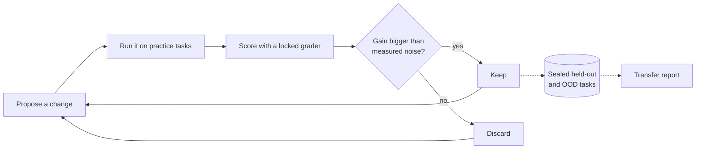
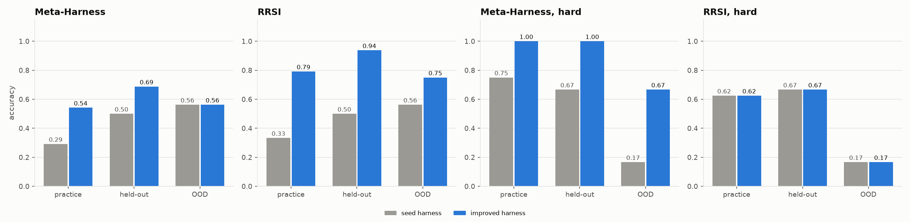
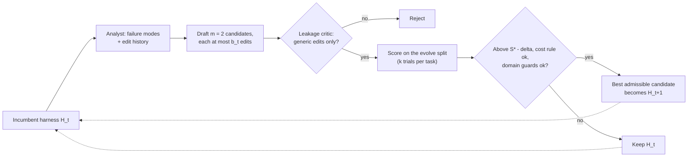
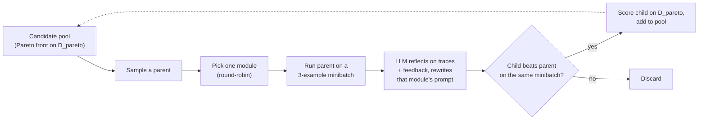
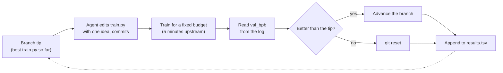
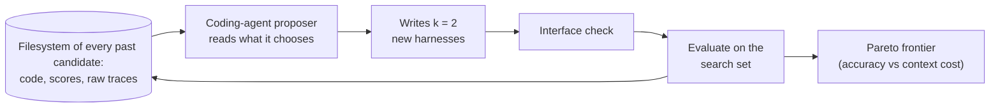
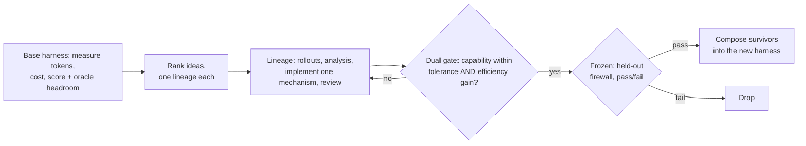
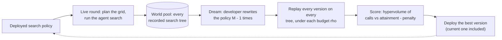
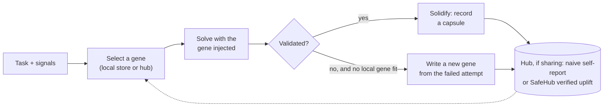
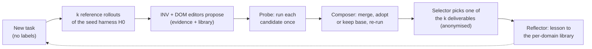

<h1 align="center">RSI: Recursive Self-Improvement Agent Skills</h1>

<p align="center"><b>This repo turns recursive self-improvement papers into agent skills.<br>
Eight methods, each rebuilt from its paper as tested code plus a Claude Code skill, so an agent can apply them<br>
to your prompts, agent harness or training script, and keep only the changes that prove themselves on tasks the loop never saw.</b></p>

<p align="center">
  
  
  
  
  
</p>

<p align="center"><a href="#1-what-this-repo-is">What it is</a> · <a href="#2-methodology">Methodology</a> · <a href="#3-install-and-use-the-skill">Install and use</a> · <a href="#4-prerequisites">Prerequisites</a> · <a href="#results-with-a-real-model">Results</a> · <a href="#choose-a-method">Methods</a> · <a href="#how-each-method-works">How they work</a> · <a href="#bring-your-own-problem">Your problem</a> · <a href="#how-we-know-it-works">Verification</a> · <a href="demo/gallery.html">66 charts</a> · <a href="docs/guide/RSI-101.md">RSI 101</a></p>

---

## 1. What this repo is

Every few weeks a new paper shows a model improving its own prompts, harness or training code. This repo turns those
recursive self-improvement (RSI) papers into tools you can use on your own task:

- **A Python package, `rsi`.** Eight methods (RRSI, GEPA, autoresearch, Meta-Harness, SoL-Pi, Dream-RSI, EvoMap,
  Harness²) rebuilt from their papers on one shared core, so they can be compared on the same tasks, grader and budget.
- **A Claude Code skill, `rsi-improve`.** It tells Claude how to apply any of those methods to your problem: set it
  up, measure the noise first, pick a method, run it with an audit trail, and report the result honestly.
- **The evidence.** Every factual claim in the skill is paired with a verbatim quote from its paper or code
  ([2,410 claims checked](docs/skill-claims/README.md)), and each paper's claims were tested against the code
  ([475 claims audited](docs/reports/claims-summary.md)).

## 2. Methodology

**From paper to skill.** Each paper (for autoresearch, the upstream repo) is read in full and rebuilt as code on a shared
core, with the paper's defaults and every place our code differs written down. The skill's description of each method
(what one round does, what it reads, how many changes it makes, its keep rule) is then checked line by line against the
paper and the code.

**One guarded loop for every method.** Self-improvement gains are hard to trust: the model grades its own work, a score
moves by luck, or a prompt quietly memorises the practice answers, and all three look like progress. A plain "keep it
if the score went up" loop accepts an unchanged artifact almost half the time. Every method here runs inside the same
safeguards:



- **Locked grader.** The artifact being improved cannot touch how it is scored.
- **Noise band.** A gain must beat the spread of re-scoring the unchanged artifact. Without one, a strict
  "keep if better" rule keeps an unchanged artifact about half the time (45-52% in our runs). RRSI applies it by
  default, GEPA and autoresearch take it as an option, and Meta-Harness, as in its paper, keeps every candidate.
- **Sealed splits.** The loop's evaluator refuses `holdout`, `ood` and `test` tasks. Only write-only monitors and your
  final transfer report read them.
- **Audit trail.** Every round records the proposal, the actual diff, the per-task scores and the keep decision.

**What to expect: the skill may not improve your problem.** With a noise band, a change is kept only when it beats the
noise, so "no change worth keeping" is a common and correct outcome. It is most likely when the starting prompt or
harness is already strong for the model, when the practice set is small or noisy, or when the model proposing changes
is weak. In that case the skill says so first ("no change beat the noise band; the original is kept") and lists what it
tried and why each was rejected, instead of presenting a lucky score as a gain. When a change is kept, the transfer
report shows whether it holds on tasks the loop never saw.

## 3. Install and use the skill

**Install.** Clone the repo and install the package:
```bash
git clone https://github.com/GaryTang32/RSI && cd RSI
pip install -e ".[science,dev]"        # or, without cloning: pip install "rsi @ git+https://github.com/GaryTang32/RSI"
```

**Add the skill to Claude Code.**
- In this repo: run `claude` in the clone. Claude Code loads `.claude/skills/` automatically.
- In another project: copy the skill, either for every project or for one:
  ```bash
  cp -r RSI/.claude/skills/rsi-improve ~/.claude/skills/            # every project
  cp -r RSI/.claude/skills/rsi-improve your-project/.claude/skills/ # one project
  ```

**Use it.** Describe the goal ("self-improve my agent's prompts", "run autoresearch on train.py") or type
`/rsi-improve`. The skill checks the setup first and asks only about what it cannot find: whether to install the
package, which model runs the loop, a spend limit, and where runs and the cache go. It then helps you wrap your task
(an artifact to change, tasks, a grader), measures the noise, picks a method and runs it.

**Try it without Claude Code.** The same loop from the command line or Python:
```bash
rsi methods                                                                  # what each method does
rsi improve --method rrsi --problem agentqa --llm sim --out runs/rrsi-sim    # offline, ~10 s, no API key
rsi inspect runs/rrsi-sim                                                    # per-round audit trail -> TRACE.md
```
Swap `--llm sim` for `--llm claude:haiku` (the `claude` CLI) or `--llm api:sonnet` (`ANTHROPIC_API_KEY`) to run live.
`sim` is a simulated model: its scores show the loop working, not real gains.

```python
import rsi
from rsi.domains.agentqa import AgentQADomain

dom = AgentQADomain()
res = rsi.improve(dom, method="rrsi", llm_task="claude:haiku", llm_propose="claude:haiku",
                  config={"T": 6}, out_dir="runs/rrsi", cache_dir=".rsi_cache/agentqa")
print(rsi.transfer_report(dom, rsi.get_llm("claude:haiku"), {"seed": res.baseline, "rrsi": res.best}, k=2))
```

## 4. Prerequisites

| Need | For | Notes |
|---|---|---|
| Python 3.10+ and `pip` | everything | the package needs only `numpy`; `[science]` adds scipy, scikit-learn and matplotlib for some domains |
| [Claude Code](https://claude.com/claude-code) | the skill | CLI, desktop, IDE or web |
| A model for live runs, one of: | running a loop for real | not needed for the offline simulator (`--llm sim`) |
| &nbsp;&nbsp;the `claude` CLI, logged in | `claude:<model>` | uses your Claude plan and counts toward its usage limits |
| &nbsp;&nbsp;`ANTHROPIC_API_KEY` and `pip install -e ".[api]"` | `api:<model>` | billed per token |
| Your problem in three parts | using it on your own task | an artifact the loop may change (prompts, a harness, a script); about 20 practice tasks plus held-out tasks it never sees; a grader that does not depend on the artifact, ideally deterministic |
| A spend limit and some patience | live runs | the skill measures the cost of one call before a run; long runs on hard tasks take hours and can stop at a usage limit, then resume from the cache |

## Results with a real model

Live runs with Claude Haiku as both the agent and the proposer, from an untouched seed. Held-out and OOD tasks were
sealed during the run and re-scored afterwards with fresh trials. **Bold** = the 95% bootstrap interval of the gain
excludes zero. Details, intervals and every candidate are in [`demo/`](demo/README.md).

| Task | Method | Practice | Held-out | Unseen kinds (OOD) | Cost |
|---|---|---|---|---|---:|
| AgentQA, standard | RRSI | 0.25 → **0.92** | 0.50 → **0.94** | 0.56 → 0.81 | $2.76 |
| AgentQA, standard | Meta-Harness | 0.17 → **0.46** | 0.31 → **0.75** | 0.56 → 0.56 | $1.71 |
| AgentQA, hard | Meta-Harness | 0.69 → 1.00 | 0.58 → 0.92 | 0.42 → 0.75 | $8.80 |
| AgentQA, hard | RRSI | 0.63 → 0.63 (kept the seed) | 0.50 → 0.50 | 0.58 → 0.58 | $7.19 |
| tinylm training script (val_bpb, lower is better) | autoresearch | 2.835 → **2.599** | 2.905 → **2.682** | 2.969 → **2.733** | $0.70 |

<p align="center"></p>

These are small task sets (6-12 tasks per split), so read them as demonstrations rather than benchmarks. The hard
Meta-Harness gains are large but not significant, and its best harness copied practice answers into its prompts; the
demo page measures what that leak was worth.

**Harness² (no grader, no labels in the loop).** On a 20-task stream of AgentQA's held-out and OOD tasks with Claude
Haiku as agent, improver and selector, accuracy went from 0.50 (the seed harness) to 0.70 at k = 1 (+0.20 [0.00, +0.45])
and **0.95 at k = 3** (+0.45 [+0.25, +0.65]); k = 3 beat k = 1 by +0.25 [+0.10, +0.45]. Total spend $13.83. k = 3 runs 12
agent rollouts per task against the seed's 1; a best-of-n baseline with the same selector gained nothing offline but was
not run live.

**More charts:** [`demo/gallery.html`](demo/gallery.html) has 66 interactive charts covering the live runs, the shared core,
every method's experiments and the verification work. Each chart says what its numbers show, including claims that did not
reproduce. Open it in a browser; it is one self-contained file.

## Choose a method

| Method | What it improves | Keep rule | Reach for it when |
|---|---|---|---|
| **RRSI** [arXiv 2609.24972](https://arxiv.org/abs/2609.24972) | an agent harness (prompts, control flow, tools) | beats the incumbent by more than the noise band, pays for its cost, passes a leakage critic | harness edits must transfer; the safe default |
| **GEPA** [arXiv 2507.19457](https://arxiv.org/abs/2507.19457) | prompts inside a multi-step system | child beats its parent on a 3-task minibatch, then joins a Pareto pool | prompts only, few rollouts, grader explains failures |
| **autoresearch** [karpathy/autoresearch](https://github.com/karpathy/autoresearch) | one script under a fixed compute budget | the metric improves (upstream rule), or a noise-aware `rigor` rule | one file, one metric, many cheap runs |
| **Meta-Harness** [arXiv 2603.28052](https://arxiv.org/abs/2603.28052) | harness code, end to end, by a coding agent | none: every candidate is kept, best on a Pareto frontier | a strong coding agent and rich execution traces |
| **SoL-Pi** [arXiv 2609.20519](https://arxiv.org/abs/2609.20519) | token-saving harness mechanisms | capability within tolerance AND an efficiency gain, then a held-out firewall | tokens or dollars are the bottleneck |
| **Dream-RSI** [arXiv 2609.14858](https://arxiv.org/abs/2609.14858) | the search strategy itself, as code | the policy that replays best over all recorded searches | long, many-attempt discovery searches |
| **EvoMap** [arXiv 2604.15097](https://arxiv.org/abs/2604.15097) | a shared library of strategy "genes" | per-task validation, then hub ranking (naive or SafeHub) | many agents sharing what they learn |

| **Harness²** [arXiv 2610.14224](https://arxiv.org/abs/2610.14224) | an agent harness, per task, with no grader or labels | none: probes contrast executions, an anonymised selector picks the deliverable, and an experience library carries lessons to later tasks | open-ended tasks with no grader, labels or validation set |

Not sure? `rsi.recommend(what_changes="prompt", prompts_only=True)` returns a ranked suggestion with its reason.

## How each method works

One loop per method, from its skill reference (`.claude/skills/rsi-improve/methods/*.md`). Dashed arrows go back to the
start of the next round or task.

<details open>
<summary><b>RRSI</b>: a few small edits per round, kept only if they beat the noise floor and pay for their cost</summary>


Each round, `b_t` shrinks (explore early, refine late) and components whose edits stopped paying are pruned.
</details>

<details>
<summary><b>GEPA</b>: reflect on traces in plain language to rewrite one prompt at a time</summary>


An optional merge step combines modules from two lineages; `res.best` is the candidate with the best D_pareto mean.
</details>

<details>
<summary><b>autoresearch</b>: one idea per experiment, keep the commit only if the metric improves</summary>


`keep_rule="rigor"` (repeated runs) or a noise-band gate replaces "better on one run".
</details>

<details>
<summary><b>Meta-Harness</b>: a coding agent reads every past harness, score and trace, then writes new ones</summary>


There is no keep rule: every valid candidate is stored; the final answer is chosen from the frontier.
</details>

<details>
<summary><b>SoL-Pi</b>: research token-saving mechanisms in isolated lineages, keep only those that pass a dual gate</summary>


The held-out result never feeds back into a lineage; it only accepts or rejects the frozen candidate.
</details>

<details>
<summary><b>Dream-RSI</b>: improve the search policy by replaying past searches, with no new agent calls</summary>


Replay reveals only recorded results, so dreaming costs CPU, not agent calls.
</details>

<details>
<summary><b>EvoMap</b>: agents distil what worked into small strategy genes and share them through a hub</summary>


The harness itself never changes; only the library of genes does.
</details>

<details>
<summary><b>Harness²</b>: improve the harness for each task with no grader, and carry lessons to the next task</summary>


Each task restarts from H0; only the library carries over. No score is read inside the loop.
</details>

## Bring your own problem

```python
import rsi
from rsi.core import Artifact, Domain, Execution, Task, TaskSuite

class MyDomain(Domain):
    def execute(self, artifact, task, *, seed, llm):        # run your artifact on one task
        ...
        return Execution(output=answer, trace=log, tokens=n_tokens)
    def grade(self, task, execution):                        # locked grader: score + feedback text
        ok = execution.output == task.target
        return float(ok), "correct" if ok else f"expected {task.target!r}"

suite = TaskSuite.from_tasks(tasks, fractions={"evolve": 0.5, "holdout": 0.5}, by_family={"ood": ["other-kind"]})
res = rsi.improve(MyDomain(suite), Artifact.from_dir("my_harness/"), method="rrsi", llm_task=..., llm_propose=...)
```

Then measure the noise band on your seed, run, and read `rsi.transfer_report`. Templates:
`experiments/{gepa,autoresearch,dream-rsi,metaharness-solpi}/example_new_problem.py`.

**Using Claude Code?** The bundled skill ([`.claude/skills/rsi-improve`](.claude/skills/rsi-improve/SKILL.md)) walks
an agent through all of this: pin down the problem, build the domain, measure noise, pick a method, run with a spend
cap, audit, and report. Each method has an end-to-end reference (round by round, task by task, keep rule, paper vs
package) written against its paper.

## How we know it works

| Check | Scope | Outcome |
|---|---|---|
| [Claims audit](docs/reports/claims-summary.md) | 475 claims from the papers, each tested against our code and experiments | 257 reproduce, 80 partly, 7 do not, 7 contradicted (mostly by the paper's own data or code), 124 need frontier models, GPUs or the original benchmarks |
| [Step-by-step validation](https://github.com/GaryTang32/RSI/blob/data/validation/README.md) | every method run from its seed, offline and live, every step re-derived by independent auditors | 2,195 of 2,370 steps verified; no keep decision miscomputed |
| [Skill claim ledger](docs/skill-claims/README.md) | every factual claim in the Claude Code skill, paired with a verbatim quote from its paper or code | 2,410 of 2,410 match; a script re-checks the quotes |
| Experiments | multiple seeds per claim, 95% bootstrap intervals | claims that failed are reported as failed |

## Repository map

| Method | Docs | Code | Tests | Experiments | Recorded results |
|---|---|---|---|---|---|
| autoresearch | [docs](docs/methods/autoresearch/README.md) | [`rsi/autoresearch`](rsi/autoresearch) | [tests](tests/autoresearch) | [scripts](experiments/autoresearch) | [data branch](https://github.com/GaryTang32/RSI/tree/data/results/autoresearch) |
| RRSI | [docs](docs/methods/rrsi/README.md) | [`rsi/rrsi`](rsi/rrsi) | [tests](tests/rrsi) | [scripts](experiments/rrsi) | [data branch](https://github.com/GaryTang32/RSI/tree/data/results/rrsi) |
| Dream-RSI | [docs](docs/methods/dream-rsi/README.md) | [`rsi/dream`](rsi/dream) | [tests](tests/dream-rsi) | [scripts](experiments/dream-rsi) | [data branch](https://github.com/GaryTang32/RSI/tree/data/results/dream-rsi) |
| EvoMap | [docs](docs/methods/evomap/README.md) | [`rsi/evomap`](rsi/evomap) | [tests](tests/evomap) | [scripts](experiments/evomap) | [data branch](https://github.com/GaryTang32/RSI/tree/data/results/evomap) |
| Harness² | [docs](docs/methods/harness2/README.md) | [`rsi/harness2`](rsi/harness2) | [tests](tests/harness2) | [scripts](experiments/harness2) | [data branch](https://github.com/GaryTang32/RSI/tree/data/results/harness2) |
| GEPA | [docs](docs/methods/gepa/README.md) | [`rsi/gepa`](rsi/gepa) | [tests](tests/gepa) | [scripts](experiments/gepa) | [data branch](https://github.com/GaryTang32/RSI/tree/data/results/gepa) |
| Meta-Harness, SoL-Pi | [docs](docs/methods/metaharness-solpi/README.md) | [`rsi/metaharness`](rsi/metaharness), [`rsi/solpi`](rsi/solpi) | [tests](tests/metaharness-solpi) | [scripts](experiments/metaharness-solpi) | [data branch](https://github.com/GaryTang32/RSI/tree/data/results/metaharness-solpi) |

<details>
<summary>Folder layout</summary>

```
rsi/            the Python package
  core/         LLM backends, Artifact, TaskSuite (sealed splits), Domain, Evaluator,
                stats (noise band, CIs), gates (keep rules), ledger, editors, leakage critic, sandbox
  <method>/     one package per method
  domains/      test problems with known ground truth (agentqa, agentworld, discovery, tinylm, ...) and public
                benchmarks (bbh, bbeh: downloaded on first use, sha256-checked, never committed)
  api.py        rsi.improve(), rsi.recommend()      cli.py  the `rsi` command      trace.py  audit trail
docs/           guide/ (RSI-101, architecture), methods/<slug>/ (paper spec, implementation, claims audit),
                core/, reports/, skill-claims/ (the skill's evidence ledger)
tests/          offline and deterministic; `pytest -m live` for checks against a real model
experiments/    reproduction scripts per method
demo/           live-run page, README and figures
.claude/skills/ the rsi-improve skill for Claude Code
```

Recorded output (`results/`, `validation/`, `demo/runs/`) lives on the
[`data`](https://github.com/GaryTang32/RSI/tree/data) branch. Restore it with
`git fetch origin data && git archive origin/data results validation demo | tar -x`.
</details>

## Limits

- Everything runs on CPU. The papers' GPU-scale experiments (nanochat, KernelBench, frontier benchmark suites) are
  reproduced qualitatively, on small analogues with known ground truth.
- Numbers from simulated domains show that a mechanism behaves as claimed. They are not benchmark results.
- Live results above use 6-12 tasks per split; most intervals are wide.
- Some per-method docs (`docs/methods/evomap`, `docs/methods/dream-rsi`) still describe earlier paper versions.
  The skill's method references are checked against the current ones.

MIT licensed.
