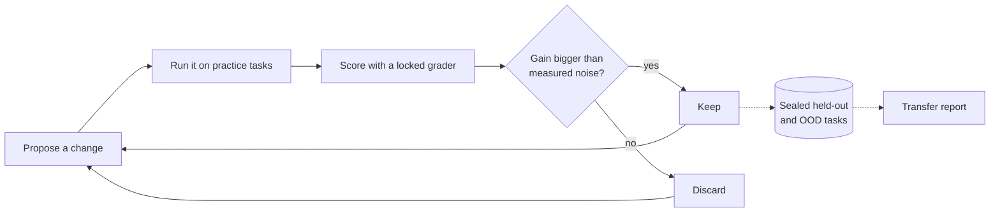

<h1 align="center">RSI</h1>

<p align="center"><b>Seven recursive self-improvement methods on one tested core.<br>
Point them at your prompts, agent harness or training script, and keep only the changes that hold up on tasks the loop never saw.</b></p>

<p align="center">
  
  
  
  
  
</p>

<p align="center"><a href="#quick-start">Quick start</a> · <a href="#results-with-a-real-model">Results</a> · <a href="#choose-a-method">Methods</a> · <a href="#bring-your-own-problem">Your problem</a> · <a href="#how-we-know-it-works">Verification</a> · <a href="demo/gallery.html">61 charts</a> · <a href="docs/guide/RSI-101.md">RSI 101</a></p>

---

Self-improving loops are easy to fool. A model that grades its own edits, a score that moves by luck, or a prompt
that memorises the practice answers will all look like progress. `rsi` runs every method through the same guarded
loop, so a gain has to survive four checks before it counts:



- **Locked grader.** The artifact being improved cannot touch how it is scored.
- **Noise band.** A gain must beat the spread of re-scoring the unchanged artifact. Without one, a strict
  "keep if better" rule keeps an unchanged artifact about half the time (45-52% in our runs).
- **Sealed splits.** The loop's evaluator refuses `holdout`, `ood` and `test` tasks. Only write-only monitors and your
  final transfer report read them.
- **Audit trail.** Every round records the proposal, the actual diff, the per-task scores and the keep decision.

## Results with a real model

Live runs with Claude Haiku as both the agent and the proposer, from an untouched seed. Held-out and OOD tasks were
sealed during the run and re-scored afterwards with fresh trials. **Bold** = the 95% bootstrap interval of the gain
excludes zero. Details, intervals and every candidate are in [`demo/`](demo/README.md).

| Task | Method | Practice | Held-out | Unseen kinds (OOD) | Cost |
|---|---|---|---|---|---:|
| AgentQA, standard | RRSI | 0.25 → **0.92** | 0.50 → **0.94** | 0.56 → 0.81 | $2.76 |
| AgentQA, standard | Meta-Harness | 0.17 → **0.46** | 0.31 → **0.75** | 0.56 → 0.56 | $1.71 |
| AgentQA, hard | Meta-Harness | 0.69 → 1.00 | 0.58 → 0.92 | 0.42 → 0.75 | $8.80 |
| AgentQA, hard | RRSI | 0.63 → 0.63 (kept the seed) | 0.50 → 0.50 | 0.58 → 0.58 | $7.19 |
| tinylm training script (val_bpb, lower is better) | autoresearch | 2.835 → **2.599** | 2.905 → **2.682** | 2.969 → **2.733** | $0.70 |

<p align="center"></p>

These are small task sets (6-12 tasks per split), so read them as demonstrations rather than benchmarks. The hard
Meta-Harness gains are large but not significant, and its best harness copied practice answers into its prompts; the
demo page measures what that leak was worth.

**More charts:** [`demo/gallery.html`](demo/gallery.html) has 61 interactive charts covering the live runs, the shared core,
every method's experiments and the verification work. Each chart says what its numbers show, including claims that did not
reproduce. Open it in a browser; it is one self-contained file.

## Quick start

```bash
pip install -e ".[science,dev]"
rsi methods                                                                  # what each method does
rsi improve --method rrsi --problem agentqa --llm sim --out runs/rrsi-sim    # offline, ~10 s, no API key
rsi inspect runs/rrsi-sim                                                    # per-round audit trail -> TRACE.md
```

Swap `--llm sim` for `--llm claude:haiku` (the `claude` CLI) or `--llm api:sonnet` (`ANTHROPIC_API_KEY`) to run live.
`sim` is a simulated model: its scores show the loop working, not real gains.

```python
import rsi
from rsi.domains.agentqa import AgentQADomain

dom = AgentQADomain()
res = rsi.improve(dom, method="rrsi", llm_task="claude:haiku", llm_propose="claude:haiku",
                  config={"T": 6}, out_dir="runs/rrsi", cache_dir=".rsi_cache/agentqa")
print(rsi.transfer_report(dom, rsi.get_llm("claude:haiku"), {"seed": res.baseline, "rrsi": res.best}, k=2))
```

## Choose a method

| Method | What it improves | Keep rule | Reach for it when |
|---|---|---|---|
| **RRSI** [arXiv 2609.24972](https://arxiv.org/abs/2609.24972) | an agent harness (prompts, control flow, tools) | beats the incumbent by more than the noise band, pays for its cost, passes a leakage critic | harness edits must transfer; the safe default |
| **GEPA** [arXiv 2507.19457](https://arxiv.org/abs/2507.19457) | prompts inside a multi-step system | child beats its parent on a 3-task minibatch, then joins a Pareto pool | prompts only, few rollouts, grader explains failures |
| **autoresearch** [karpathy/autoresearch](https://github.com/karpathy/autoresearch) | one script under a fixed compute budget | the metric improves (upstream rule), or a noise-aware `rigor` rule | one file, one metric, many cheap runs |
| **Meta-Harness** [arXiv 2603.28052](https://arxiv.org/abs/2603.28052) | harness code, end to end, by a coding agent | none: every candidate is kept, best on a Pareto frontier | a strong coding agent and rich execution traces |
| **SoL-Pi** [arXiv 2609.20519](https://arxiv.org/abs/2609.20519) | token-saving harness mechanisms | capability within tolerance AND an efficiency gain, then a held-out firewall | tokens or dollars are the bottleneck |
| **Dream-RSI** [arXiv 2609.14858](https://arxiv.org/abs/2609.14858) | the search strategy itself, as code | the policy that replays best over all recorded searches | long, many-attempt discovery searches |
| **EvoMap** [arXiv 2604.15097](https://arxiv.org/abs/2604.15097) | a shared library of strategy "genes" | per-task validation, then hub ranking (naive or SafeHub) | many agents sharing what they learn |

Not sure? `rsi.recommend(what_changes="prompt", prompts_only=True)` returns a ranked suggestion with its reason.

## Bring your own problem

```python
import rsi
from rsi.core import Artifact, Domain, Execution, Task, TaskSuite

class MyDomain(Domain):
    def execute(self, artifact, task, *, seed, llm):        # run your artifact on one task
        ...
        return Execution(output=answer, trace=log, tokens=n_tokens)
    def grade(self, task, execution):                        # locked grader: score + feedback text
        ok = execution.output == task.target
        return float(ok), "correct" if ok else f"expected {task.target!r}"

suite = TaskSuite.from_tasks(tasks, fractions={"evolve": 0.5, "holdout": 0.5}, by_family={"ood": ["other-kind"]})
res = rsi.improve(MyDomain(suite), Artifact.from_dir("my_harness/"), method="rrsi", llm_task=..., llm_propose=...)
```

Then measure the noise band on your seed, run, and read `rsi.transfer_report`. Templates:
`experiments/{gepa,autoresearch,dream-rsi,metaharness-solpi}/example_new_problem.py`.

**Using Claude Code?** The bundled skill ([`.claude/skills/rsi-improve`](.claude/skills/rsi-improve/SKILL.md)) walks
an agent through all of this: pin down the problem, build the domain, measure noise, pick a method, run with a spend
cap, audit, and report. Each method has an end-to-end reference (round by round, task by task, keep rule, paper vs
package) written against its paper.

## How we know it works

| Check | Scope | Outcome |
|---|---|---|
| [Claims audit](docs/reports/claims-summary.md) | 475 claims from the papers, each tested against our code and experiments | 257 reproduce, 79 partly, 7 do not, 9 contradicted (mostly by the paper's own data or code), 123 need frontier models, GPUs or the original benchmarks |
| [Step-by-step validation](https://github.com/GaryTang32/RSI/blob/data/validation/README.md) | every method run from its seed, offline and live, every step re-derived by independent auditors | 2,195 of 2,370 steps verified; no keep decision miscomputed |
| [Skill claim ledger](docs/skill-claims/README.md) | every factual claim in the Claude Code skill, paired with a verbatim quote from its paper or code | 2,159 of 2,159 match; a script re-checks the quotes |
| Experiments | multiple seeds per claim, 95% bootstrap intervals | claims that failed are reported as failed |

## Repository map

| Method | Docs | Code | Tests | Experiments | Recorded results |
|---|---|---|---|---|---|
| autoresearch | [docs](docs/methods/autoresearch/README.md) | [`rsi/autoresearch`](rsi/autoresearch) | [tests](tests/autoresearch) | [scripts](experiments/autoresearch) | [data branch](https://github.com/GaryTang32/RSI/tree/data/results/autoresearch) |
| RRSI | [docs](docs/methods/rrsi/README.md) | [`rsi/rrsi`](rsi/rrsi) | [tests](tests/rrsi) | [scripts](experiments/rrsi) | [data branch](https://github.com/GaryTang32/RSI/tree/data/results/rrsi) |
| Dream-RSI | [docs](docs/methods/dream-rsi/README.md) | [`rsi/dream`](rsi/dream) | [tests](tests/dream-rsi) | [scripts](experiments/dream-rsi) | [data branch](https://github.com/GaryTang32/RSI/tree/data/results/dream-rsi) |
| EvoMap | [docs](docs/methods/evomap/README.md) | [`rsi/evomap`](rsi/evomap) | [tests](tests/evomap) | [scripts](experiments/evomap) | [data branch](https://github.com/GaryTang32/RSI/tree/data/results/evomap) |
| GEPA | [docs](docs/methods/gepa/README.md) | [`rsi/gepa`](rsi/gepa) | [tests](tests/gepa) | [scripts](experiments/gepa) | [data branch](https://github.com/GaryTang32/RSI/tree/data/results/gepa) |
| Meta-Harness, SoL-Pi | [docs](docs/methods/metaharness-solpi/README.md) | [`rsi/metaharness`](rsi/metaharness), [`rsi/solpi`](rsi/solpi) | [tests](tests/metaharness-solpi) | [scripts](experiments/metaharness-solpi) | [data branch](https://github.com/GaryTang32/RSI/tree/data/results/metaharness-solpi) |

<details>
<summary>Folder layout</summary>

```
rsi/            the Python package
  core/         LLM backends, Artifact, TaskSuite (sealed splits), Domain, Evaluator,
                stats (noise band, CIs), gates (keep rules), ledger, editors, leakage critic, sandbox
  <method>/     one package per method
  domains/      test problems with known ground truth (agentqa, agentworld, discovery, tinylm, ...)
  api.py        rsi.improve(), rsi.recommend()      cli.py  the `rsi` command      trace.py  audit trail
docs/           guide/ (RSI-101, architecture), methods/<slug>/ (paper spec, implementation, claims audit),
                core/, reports/, skill-claims/ (the skill's evidence ledger)
tests/          offline and deterministic; `pytest -m live` for checks against a real model
experiments/    reproduction scripts per method
demo/           live-run page, README and figures
.claude/skills/ the rsi-improve skill for Claude Code
```

Recorded output (`results/`, `validation/`, `demo/runs/`) lives on the
[`data`](https://github.com/GaryTang32/RSI/tree/data) branch. Restore it with
`git fetch origin data && git archive origin/data results validation demo | tar -x`.
</details>

## Limits

- Everything runs on CPU. The papers' GPU-scale experiments (nanochat, KernelBench, frontier benchmark suites) are
  reproduced qualitatively, on small analogues with known ground truth.
- Numbers from simulated domains show that a mechanism behaves as claimed. They are not benchmark results.
- Live results above use 6-12 tasks per split; most intervals are wide.
- Some per-method docs (`docs/methods/evomap`, `docs/methods/dream-rsi`) still describe earlier paper versions.
  The skill's method references are checked against the current ones.

MIT licensed.
