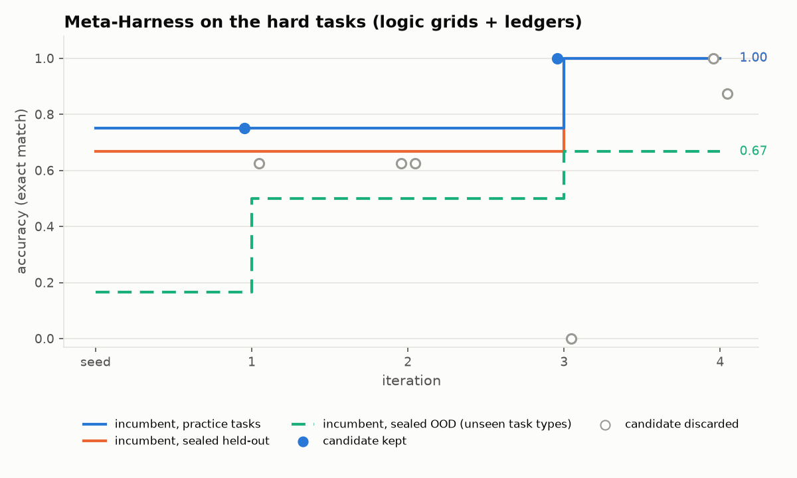
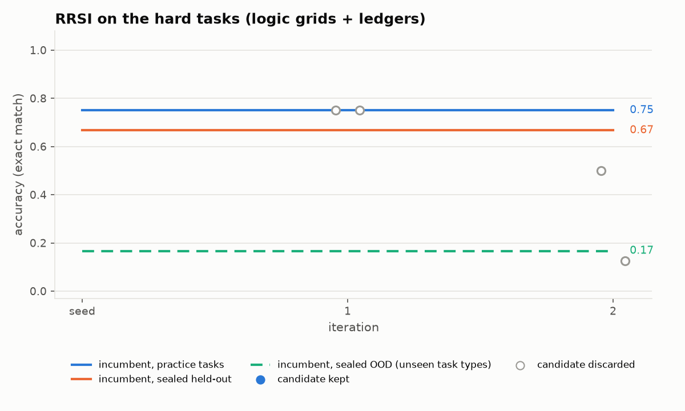
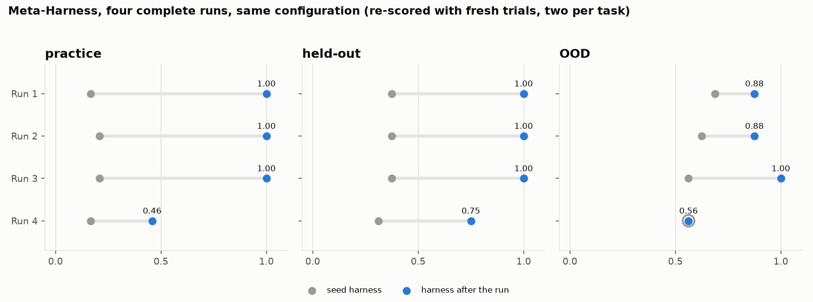
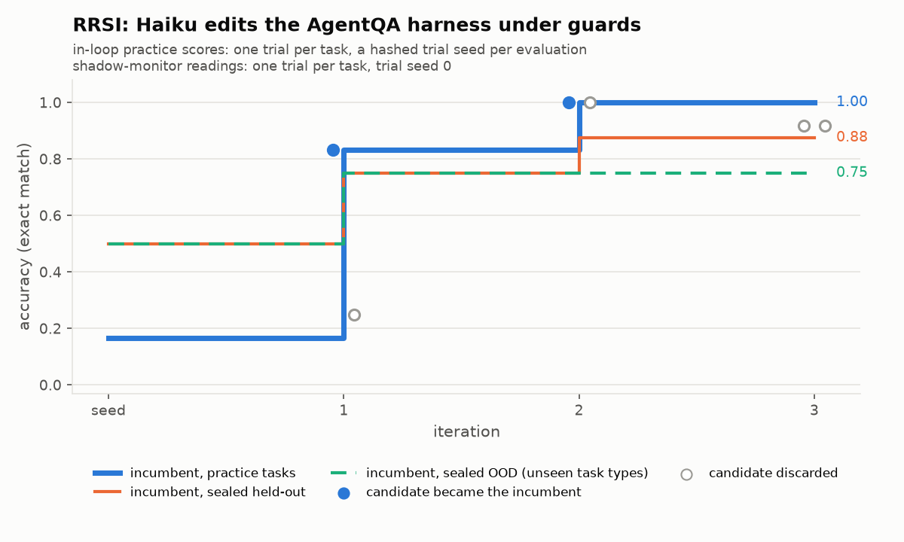
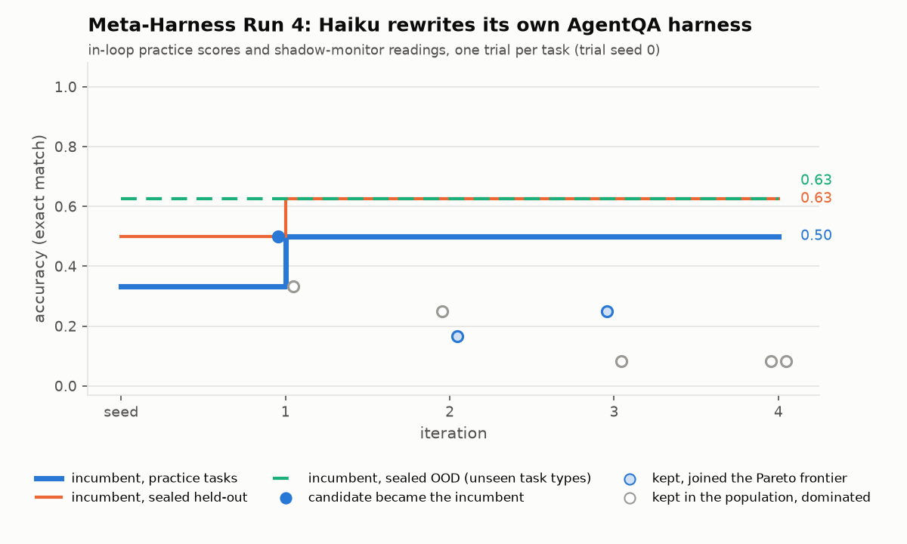
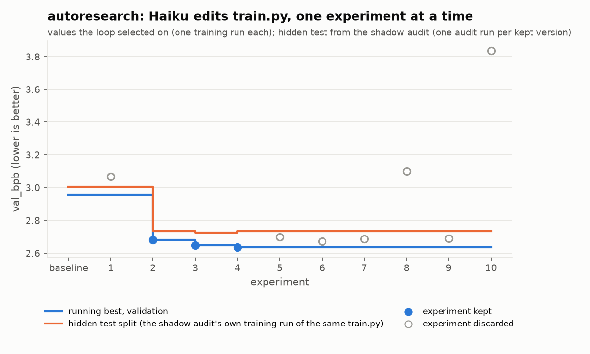

# Live demo: the package improving a real LLM agent

Every run here started from an untouched seed. In the AgentQA runs (Meta-Harness and RRSI), Claude Haiku was both the frozen task model and the proposer, and a locked exact-match grader scored every candidate. Their held-out and OOD tasks are sealed: the loop never saw any of those tasks or their scores. A write-only shadow monitor scored each new incumbent on them for the charts. In autoresearch, Haiku edits a training script and each experiment is scored by validation bits per byte.

The proposer's domain description does name the OOD kinds, and so does RRSI's critic's:
- on the hard suite, "business-day scheduling, chained text transformations";
- on the standard suite, "dates, text manipulation, list statistics, number theory".

So the OOD column measures transfer to unseen tasks of announced kinds.

For charts of every method's experiments as well as these runs, open [`gallery.html`](gallery.html) (61 interactive charts).

The AgentQA headline numbers come from a re-score after each run with fresh trials. It uses trial seeds 100 and 101, which no loop decision and no monitor reading used ([how the numbers were measured](#how-the-numbers-were-measured)). The autoresearch numbers come from three fresh training runs per version. The interactive version is `demo/index.html`. It shows every candidate, what became of it and the code each run produced.

## Results

### Hard AgentQA

The practice tasks are 5×5 logic grids and messy transaction ledgers. The OOD tasks are business-day scheduling and chained string transformations. There are 8 practice, 6 held-out and 6 OOD tasks.

| Run | Method | Practice | Held-out | OOD | Cost |
|---|---|---|---|---|---:|
| `runs/metaharness_hard` | Meta-Harness | 0.69 → 1.00 | 0.58 → 0.92 | 0.42 → 0.75 | $8.80 |
| `runs/rrsi_hard` | RRSI | 0.63 → 0.63 (kept the seed) | 0.50 → 0.50 | 0.58 → 0.58 | $7.19 |

### Standard AgentQA

The practice tasks are large-number arithmetic (digit sums, modular arithmetic, bit counts) plus one word problem. The OOD tasks are dates, number theory, strings and lists. There are 12 practice, 8 held-out and 8 OOD tasks.

| Run | Method | Practice | Held-out | OOD | Cost |
|---|---|---|---|---|---:|
| `runs/metaharness` (Run 4) | Meta-Harness | 0.17 → **0.46** | 0.31 → **0.75** | 0.56 → 0.56 | $1.71 |
| `runs/rrsi` | RRSI | 0.25 → **0.92** | 0.50 → **0.94** | 0.56 → 0.81 | $2.76 |

### autoresearch (tinylm)

Haiku edits `train.py` of a tiny byte-level language model; each experiment trains for 8 s on the CPU and is kept only if its validation bits per byte (val_bpb) improve. The hidden test splits are sealed: only the locked evaluator reads them, in an audit whose results the loop never sees.

| Run | Method | Validation (val_bpb) | Hidden test | Shifted test | Cost |
|---|---|---|---|---|---:|
| `runs/autoresearch` | autoresearch | 2.835 → **2.599** | 2.905 → **2.682** | 2.969 → **2.733** | $0.70 |

**How to read the tables.**
- **Cells.** Each AgentQA cell is seed → final, with two fresh trials per task.
- **Bold.** Bold marks a gain whose recorded 95% bootstrap confidence interval (5,000 resamples, paired over tasks) excludes 0. Every bold cell keeps its status with 200,000 resamples. The intervals are on the page; for Runs 1–3 they are in `demo/replicates.json`. For autoresearch, bold means the three training runs' ranges do not overlap.
- **Hard Meta-Harness.** Its gains are +0.31 [0, +0.63] on practice, +0.33 [−0.08, +0.75] on held-out and +0.33 [−0.33, +0.83] on OOD, so none is bold. The practice bound is borderline:
  - only 3 of the 8 practice tasks changed, all for the better;
  - the recorded bound of 0 is Monte-Carlo noise (5,000 resamples), and the exact bootstrap bound is +0.06;
  - an exact sign-flip test on the 3 changed tasks gives p = 0.25.

  Sampling noise is large too: the same seed harness, re-scored with the same trial seeds in the two hard runs' separate caches, scored 0.69 / 0.58 / 0.42 and 0.63 / 0.50 / 0.58.
- **autoresearch.** Lower is better. Each cell is the mean of three fresh training runs of the baseline and final `train.py` (seeds 10000–10002), all three splits scored on the same models by `experiments/demo/autoresearch_hidden.py` (CPU only, no model calls).
  - **Sessions differ.** Training stops after 8 s of wall-clock time, so a seed fixes the data order but not the number of steps. A session's results depend on the machine and its load, so compare splits only within one session. The run's own post-run re-evaluation, in an earlier session at the same seeds, gave 2.952 → 2.653 on validation. These runs scored lower (baseline validation 2.835 vs 2.952), most likely because they fit more training steps into the 8 s. The loop selected on 2.956 → 2.637.

**Cost.** Cost is every Haiku call the run's attempts made: for Meta-Harness in the loop, the shadow monitor and the one-time final test evaluation; for RRSI in the loop and the shadow monitor; for autoresearch by the research agent (its hidden-test audit is CPU training). That includes attempts cut short by the account's usage cap, a container restart or a crash; the final attempt replayed from the cache the calls it repeated. The fresh re-scores and each run's original post-run report are listed separately under [Spend](#spend).









The Meta-Harness and RRSI iteration charts show in-loop practice scores and shadow-monitor readings, one trial per task. Meta-Harness's practice scores and every monitor reading use trial seed 0; RRSI draws a hashed trial seed for each evaluation (`job_seeds` in `rsi/rrsi/evaluate.py`), and its rounds 0, 1, 2 are iterations 1, 2, 3 on the charts. The autoresearch chart shows one training run per experiment. The tables above are the fresh re-score, so their values differ.

## What happened

### Meta-Harness, hard tasks

- **What it found.** No single trick solves these tasks. Haiku solves the logic grids by reasoning, but its brute-force code usually times out. On the ledgers its arithmetic without code is unreliable, and with code it is reliable.
- **The router.** Iteration 3 produced `hybrid-task-router`, the run's 5th candidate. Its proposer built it by combining two earlier candidates: `clear-format-answers`, strong on the logic grids, and `code-generation-with-templates`, strong on the ledgers.
  - **Routing rule.** A question with more data words (transactions, totals, dates) than logic words goes to a write-the-code-and-run-it path. Everything else, ties included, goes to step-by-step reasoning.
  - **Scores.** In the loop it scored 1.0 on practice, and the monitor's single held-out reading was also 1.0. With fresh trials it scored 1.00 on practice, 0.92 on held-out (one logic trial missed) and 0.75 on OOD.
  - **Scheduling vs ciphers.** Scheduling questions mention dates, so they go to code: 0 → 1.0. Ciphers match no data word and fall to reasoning, where the router did worse than the seed: 0.83 → 0.50. The keyword lists are tuned to the practice families.
- **Copied strings.** Faithful Meta-Harness has no leakage guard, as in the paper. From iteration 1 on, most candidates copied strings from practice traces into their prompts as format examples. The router's prompts contain:
  - three practice answers: `2379.20` (also written `$2,379.20`), `Harper` and `Delta`;
  - a ledger customer name, `Cobalt`, which is no task's answer;
  - one practice task's exchange rate, `EUR_RATE = 1.145`.

  `Delta` is also the answer of one held-out ledger task. That task routes to the code path, whose prompts do not contain it.
- **Leak check.** `experiments/demo/leak_ablation.py` replaced every one of those strings with a neutral one. Before scoring, it checks that no task's answer and no practice exchange rate remains. It then scored both versions on the same fresh trials:

  | Split | Router as found | Neutralised copy | Paired difference (95% CI) |
  |---|---|---|---|
  | Practice | 1.00 | 1.00 | 0 |
  | Held-out | 0.92 | 1.00 | +0.08 [0, +0.25] |
  | OOD | 0.75 | 0.67 | −0.08 [−0.50, +0.25] |

  - **Held-out.** The two versions differ in one trial: `holdout-logic-004`, which the router as found missed once. The held-out ledger task whose answer, `Delta`, was copied scored 2/2 with and without it.
  - **OOD.** The versions disagree on three cipher trials, in both directions: one cipher went from 1/2 to 2/2 and another from 2/2 to 0/2, a net of −1 of 12. No copied string is an OOD answer.

  There is no sign the copied text drove the result. With 6 tasks per sealed split, a small effect cannot be ruled out. (A first check, now in `leak_ablation_v1.json`, missed the comma-formatted `$2,379.20` and the exchange rate; it is superseded and not replayed.)

### RRSI, hard tasks

RRSI kept the seed.
- **Round 0.** Both candidates tied the seed on practice (0.75 in the loop) but cost more tokens, so the cost rule rejected them.
- **Round 1.** Both fell below the noise-adjusted floor of 0.55, at 0.50 and 0.125.
- **Leakage critic.** The critic is an LLM review; the answer-denylist precheck was off. It rejected the first draft of one candidate per round:
  - in round 0, because the draft declared two edits it did not make;
  - in round 1, because the edit's description named a practice task and its answer (the repair changed only that description).

  It passed both round-0 candidates although each quoted the practice answer `Sawyer`. One put it in its system prompt as a format example, the same kind of copy as in the Meta-Harness router; the other quoted it in a code comment. Neither was kept.
- **Budget.** The $5 cap is checked between rounds, and the cap then stopped the run after 2 of its 4 rounds. The 45-minute wall-clock cap had also run out (3,629 s). By the run's own accounting:
  - round 1 started at $4.29: $3.30 live plus $0.99 replayed from an earlier attempt that crashed during calibration;
  - it ended at $6.49: $5.39 live plus $1.10 replayed.

  $0.11 of that replay is the second round-1 candidate's smoke test reusing the first one's cached calls, which the ledger counts again.

This is not a controlled comparison with Meta-Harness. There is one run of each, and RRSI's overhead (one calibration, then per-round failure analysis, critic repairs and smoke tests) meant its cap allowed only 4 candidates. Meta-Harness, with no cap, found its router at its 5th candidate. After 4 candidates, neither method had beaten the seed on practice. Whether RRSI would find something like the router with all 4 rounds is untested.

### Meta-Harness on the standard tasks: four runs

There were four complete runs with the same configuration. The replay fix landed between them, so the code changed slightly from run to run.

| Run | Practice | Held-out | OOD | What it found |
|---|---|---|---|---|
| Run 1 | 0.17 → **1.00** | 0.38 → **1.00** | 0.69 → 0.88 | code execution at iteration 2; its final harness answers most tasks with hard-coded regex templates |
| Run 2 | 0.21 → **1.00** | 0.38 → **1.00** | 0.63 → 0.88 | write Python, run it with the tool, read the printed answer |
| Run 3 | 0.21 → **1.00** | 0.38 → **1.00** | 0.56 → **1.00** | the same |
| Run 4 | 0.17 → **0.46** | 0.31 → **0.75** | 0.56 → 0.56 | better answer extraction; never executed code |

All four runs are fresh re-scores, two trials per task.

- **Run 1.** At iteration 2 it found code execution: `code_execution` scored 1.0 in the loop. Iteration 3's `pattern_template_solver` matched that score at lower cost and became the final harness.
  - **Templates.** It hard-codes five regex templates covering four of the generator's six question shapes, and runs fixed Python for them without calling the model. In the fresh re-score, the templates answered 10 of 12 practice and 5 of 8 held-out tasks.
  - **Fallback.** Model-written code handled only the other 5 practice and held-out tasks and all 8 OOD tasks.
  - **Leaked text.** Its comments quote six practice questions.
- **Run 4 never executed code.** From iteration 2 on, its candidates told Haiku to write and run Python, but none called the Python tool: there were 0 tool calls in all 96 candidate task runs.
  - **Made-up outputs.** Haiku printed imitation tool calls with made-up, often wrong outputs, e.g. `ANSWER: 63` for 40627866717431 mod 148, which is 91.
  - **Failures.** Those six candidates scored 0.08–0.25 in the loop. 59 of their 61 failures were wrong answers. 2 were extraction losses: the reply stated the right number, but the harness extracted another.
  - **The proposer's misreading.** The proposer's iteration-3 report says the "Model runs `print(result) = 144` then later writes "ANSWER: 169"". No trace contains a Python output of 144: the report describes an observation that never happened.

One run is an anecdote. The spread across runs is the result. Three of four runs found code execution. Runs 2 and 3 reached 1.0 on practice and held-out with a general write-and-run harness; Run 1's final 1.0 rests mostly on templates keyed to the generator's question shapes.

### RRSI, standard tasks

- **Round 0.** It kept a general fix: parse the Python in the model's reply, run it with the tool, and force a follow-up grounded in the tool output. In-loop practice went 0.17 → 0.83.
- **Round 1.** It reached 1.0 in the loop.
- **Round 2.** Both candidates scored 0.92, inside the noise band, and the cost rule rejected them. The $2.50 budget then stopped the run.
- **Leakage critic.** It rejected the first draft of both kept edits and passed them after repair. One draft's system prompt listed the suite's numeric domains, with a formula example for each. The other's code was general, but its edit description named task ids and their answers.

The final harness contains no task answer, task id or question text. The fresh re-score puts it at 0.92 on practice, below the loop's 1.0: the loop's single-trial winner was partly lucky. It also scored 0.94 on held-out and 0.81 on OOD.

### autoresearch

Three changes were kept: learning rate 0.003 → 0.01 → 0.02, then hidden width 128 → 256.
- **The last keep.** It improved validation by 0.011 in the loop, inside the run's noise. Re-running that commit gave 2.664, worse than the previous keep's 2.648.
- **Hidden splits, one run.** The shadow audit trained each kept version once. That single run made the last keep look worse on the shifted split, 2.780 → 2.846.
- **Three runs, one later session.** Over three fresh training seeds the last keep showed no improvement. Validation went 2.591 → 2.599 and the in-distribution test 2.669 → 2.682, both slightly worse at each seed. The shifted test was unchanged, 2.736 → 2.733.

The strict keep rule locked in noise, and one training run per version was too few to judge it.

## How the numbers were measured

A Meta-Harness or RRSI run produces three kinds of score:
- **In-loop scores.** The practice scores the loop decided on: one trial per task, trial seed 0 for Meta-Harness, and a hashed seed per evaluation for RRSI. They carry selection bias: the winner is the candidate whose sample happened to score highest.
- **Shadow-monitor readings.** The sealed held-out and OOD scores of each new incumbent (one trial per task, trial seed 0). The loop never saw them; they are the orange and green lines on the charts.
- **The fresh re-score.** Each run's seed and final harness on every split, two trials per task, with trial seeds 100 and 101. The re-score is `experiments/demo/rescore.py`, written to each run's `rescore.json`; runs recorded from now on get it from `live_demo.py`. These are the tables above.

The LLM cache is keyed on the trial seed. The first version of the post-run report used seeds from 0, so its trial 0 replayed the monitor's samples and, for Meta-Harness, the loop's own practice samples. On the hard Meta-Harness run it made no new model call at all: its "re-scored" 1.00 on practice was the sample that selected the router. That report is still in each run's `summary.json` (`transfer`); `rescore.json` supersedes it. `transfer_report(seed_offset=...)` makes the independent re-score possible.

## The replay fix, and a verified replay

Meta-Harness runs used to be impossible to replay from their LLM cache, because the proposer's prompt was different on every run. Three things fed run-varying text into it:
- wall-clock fields (`created_at`, `latency_s`, `runtime_seconds`, `timing_s`, `seconds`, `wall_s`, `elapsed_s`) in the files the proposer reads;
- the proposer's own bill in its session record, which a cached replay meters as $0;
- the sandbox's random scratch path (`/tmp/rsi_sbx_k3j9x/...`) inside tracebacks, which also reached the task model through tool output.

The fix:
- **Volatile fields.** `ExperienceStore.view(strip_volatile=True)` drops those fields from the files the store writes. It leaves candidate sources and raw execution traces exactly as written. `Config.deterministic_view` is on by default.
- **Stable sandbox path.** The sandbox reports a stable path, `/tmp/rsi_sandbox`, and replaces the longer path first when the temp directory is a symlink. Sandboxed code also runs with `PYTHONHASHSEED=0`, so printed sets come out in the same order every run.
- **Tests.** `tests/metaharness-solpi/test_metaharness_deterministic_view.py` and `tests/core/test_core_sandbox_stable_paths.py`.

**Proof.** `python experiments/demo/live_demo.py metaharness [--suite hard] --replay-check` re-runs a finished run from its cache with the model switched off, so any cache miss is an error. It compares every proposer prompt, every candidate's practice score and execution trace, the seed's score, every shadow-monitor reading and every final test result with the run. A failing or interrupted first check is not recorded. A repeat check replays into a scratch directory and must also reproduce the recorded `<run>_replay/replay_check.json`, trace counts included. Both checks below ran on the current code:

| Replayed run | Proposer calls | Candidate scores | Seed score, monitor readings, final test results | Cache hits / misses | Execution traces | Sandboxed calls (practice) | Spent |
|---|---|---|---|---|---|---|---:|
| Run 4 (standard) | 4 of 4 prompts identical | 8 of 8 identical | 1, 4 and 8, all identical | 208 / 0 | 108 of 108 identical | 0 | $0 |
| Hard Meta-Harness | 4 of 4 prompts identical | 8 of 8 identical | 1, 6 and 12, all identical | 192 / 0 | 72 of 72 identical | 62 | $0 |

Each run made one proposer call per iteration, yielding 2 candidates.
- **What the prompt check verifies.** Both checks verify the store view and the proposer bill.
- **Run 4 ran no code.**
- **The hard run executed model-written code.** It made 62 sandboxed calls in its practice evaluations (more in the monitor and the final test), 12 of which hit the 10-second timeout. No sandbox path reached any prompt in this run: every harness makes its model calls before it runs code, and the proposer prompts hold no traceback. So the prompt check would have passed with random paths too.
- **Traces.** The replay reproduced all 72 of the hard run's candidate execution traces byte for byte (and all 108 of Run 4's). That includes the 12 timeouts and 14 lines (in 13 tracebacks) naming `/tmp/rsi_sandbox`, and no random scratch path. The stable path and `PYTHONHASHSEED=0` are also covered by `tests/core/test_core_sandbox_stable_paths.py`.
- **Zero misses proves the full prompts matched**, because the cache is keyed on a hash of the whole prompt. The trace keeps only their first 60,000 characters.
- **Forked children.** Hits and misses are counted in the main process. A miss in a forked interface-validation child would fail its smoke check and show as a score mismatch.
- **Before the fix.** Replays of Runs 2 and 3, each on code with only part of the fix, failed. Run 2's failed on the proposer bill, and Run 3's on random sandbox paths.

**What can still vary.** These can still make a replay miss:
- output of model-written code that is not deterministic (object addresses, the current time, unseeded randomness);
- a wall-clock timeout that lands differently under another machine's load;
- error messages, which are recorded verbatim (a usage-cap message carries its reset time) and reach later proposer prompts.

Exact replay also covers only the rewrite proposer used here. The coding-agent proposer (`proposer_kind="agent"`) bypasses the LLM cache.

**Resuming a run cut short.** The account usage cap cut Run 4 off after iteration 3. The attempt was moved to `runs/_archive/metaharness_v3_capped` and the same command run again. It replayed the seed evaluation and iterations 1–3 from the cache for $0 (119 cached calls, which had cost $1.35 before the cap) and ran iteration 4 live.

The hard Meta-Harness run was resumed the same way after two container restarts and a second cap. RRSI on the hard tasks reused the cache of an earlier attempt that crashed during calibration. `live_demo.py --resume` now does the archiving step itself.

## Harder tasks

`rsi/domains/agentqa/hard.py` adds four families, built with `make_hard_suite()` and the `--suite hard` option:

| Family | Role | What it is |
|---|---|---|
| `logic` | practice | 5-house × 5-attribute logic grids, each with a unique solution |
| `ledger` | practice | 64–93-row exports (60–85 transactions plus 4–8 correction rows) with three date formats, European amounts, status synonyms and FX; asked as one exact figure or the top customer |
| `schedule` | sealed OOD (kind named to the proposer) | business days over holidays |
| `cipher` | sealed OOD (kind named to the proposer) | 5–7 chained string transformations |

`tests/core/test_agentqa_hard.py` re-derives every task of a 34-task suite and of the demo's suite from the question text alone:
- the logic grids with an independent search;
- the ledgers by re-parsing every row;
- the schedules with numpy's business-day calendar;
- the ciphers by applying each step as worded, checking that every operation occurs.

Calibration on the default hard suite (seed 0: 12 practice tasks and 8 OOD tasks), one trial per task. It replays at $0 with `python experiments/demo/calibrate_hard.py` (offline), which compares every score with `runs/_archive/calibrate_hard.json`, transcribed from the live run's output:

| Harness | Logic | Ledger | Schedule (OOD) | Cipher (OOD) |
|---|---:|---:|---:|---:|
| Plain one-call seed | 1.0 | 0.0 | 0.25 | 0.75 |
| "Write Python and run it" | 0.0 (11 of its 12 code executions, two per task, timed out; 1 crashed) | 1.0 | 1.0 | 1.0 |

The seed row is one trial per task and partly measures answer format. The seed returns its reply's last line:
- **Ledgers.** In 3 of the 6 ledger replies (all three "which customer" questions), the reply named the correct customer, but the line the seed returns, its last, was a breakdown row or a full sentence rather than the bare answer. The three "average" ledgers were real arithmetic misses, off by cents.
- **Schedules.** In 2 of the 3 failed schedule replies, the reply stated the correct date above the last line.
- **Sample variation.** The same seed solved 2 of the same 4 practice ledgers in the hard Meta-Harness run.

Even so, no single trick wins. Plain reasoning gets the logic grids right but is unreliable on the ledgers' exact arithmetic. Code gets the arithmetic right, but its brute force times out on the grids.

## Spend

The whole demo cost $56.38 of live Haiku calls. `experiments/demo/spend.py` sums every LLM cache and credits each call to the attempt that was running when it was written (calls made from now on, to the attempt whose cache-write journal lists them). Its outputs are the record: `demo/spend.json`, and `demo/spend_entries.json`, which names the attempt of every cache entry because git does not keep the write times the attribution needs. The total counts every successful call. A call that failed or timed out is not cached, so it is not counted, whether or not it was billed.

| What | Cost |
|---|---:|
| Meta-Harness, hard tasks: four attempts cut short (two by the usage cap, two by container restarts), then the final one | $8.80 |
| RRSI, hard tasks: an attempt that crashed in calibration (4 of 8 trials lost to infrastructure errors), then the final one | $7.19 |
| RRSI, standard tasks: a restarted attempt, then the final one | $2.76 |
| Meta-Harness Run 4: cut off by the usage cap after iteration 3, then resumed | $1.71 |
| Meta-Harness Runs 1–3 ($2.78, $1.39, $2.30) | $6.46 |
| The interrupted replicate (`runs/metaharness_a`) | $2.50 |
| autoresearch | $0.70 |
| Original post-run reports (trial seeds from 0, superseded by the fresh re-scores) | $2.41 |
| Fresh re-scores of the seven re-scored runs (hard and standard Meta-Harness and RRSI runs, Runs 1–3) | $11.92 |
| Leak checks (the first $2.55, the complete one $2.90) | $5.46 |
| Hard-suite calibrations | $6.48 |
| **Total** | **$56.38** |

Rows are rounded separately, so they sum to $56.39. Run 1 shares its cache with the interrupted replicate. Its seed evaluation and seed monitor reading replayed the replicate's entries (about $0.18), so that cost sits in the replicate's row.

**Integrity checks.**
- **What the check covers.** `experiments/demo/live_demo.py`'s `infra_errors` scans a run's trace for lost model calls:
  - trials missing from loop evaluations, monitor readings and the re-score;
  - any recorded error of RRSI's critic, digester and analyst calls;
  - candidates RRSI dropped as `eval_invalid`, and trials missing from RRSI's evaluation files (`evals/*.json`, which include its calibration repeats);
  - infrastructure errors on proposals and gates.
- **Results.** Every reported run, the replicates and the restarted RRSI attempt scan clean. So does every `rescore.json`, which records the same check for its own trials.
- **Monitor readings.** The recorded runs' monitor events predate the missing-trial count, so the scan cannot see a lost monitor trial in them. `experiments/demo/monitor_check.py` replays every shadow-monitor reading of the reported AgentQA runs and replicates offline instead. All 46 readings, across those eight runs, reproduce exactly with no missing trial and 0 cache misses; each run's `monitor_check.json` records them. Not replayed: the 16 readings in the traces of the seven early-ended attempts under `runs/_archive/`, the archived replays, and autoresearch's shadow audit (CPU training, no model call).
- **Older summaries.** The summaries of `rrsi`, `autoresearch` and Runs 1–3 predate the check. Those of `metaharness`, `metaharness_hard` and `rrsi_hard` carry an earlier version of it. Their traces were scanned afterwards.
- **Chain.** `run_chain.sh` stops at the first job that exits non-zero or whose log reports a usage cap, `INFRA_ERRORS` or missing trials.
- **Early-ended attempts.** Attempts that ended early sit under `runs/_archive/`, with their logs. The logs of the two container-restarted hard attempts and of the restarted RRSI attempt are empty; their traces are the record. The interrupted replicate `runs/metaharness_a` is shown on the page.

## Reproduce

Checks of the committed results, all $0 with no model call (a cache miss is an error). Each exits non-zero on any difference:

```bash
python experiments/demo/live_demo.py metaharness [--suite hard] --replay-check   # replay a finished run; compare with it and its record
python experiments/demo/rescore.py [run]          # replay every recorded re-score (rescore.json, any rescore_s<N>.json)
python experiments/demo/rescore.py --seed-offset N [run]   # only the recorded rescore_s<N>.json
python experiments/demo/leak_ablation.py          # replay leak_ablation.json (and any leak_ablation_s<N>.json); compare
python experiments/demo/monitor_check.py          # replay the reported runs' shadow-monitor readings; compare with the traces
python experiments/demo/calibrate_hard.py         # replay the hard-suite calibration; compare with _archive/calibrate_hard.json
python experiments/demo/spend.py                  # recompute the spend record and compare
python experiments/demo/plot_demo.py && python experiments/demo/build_page.py && git diff --exit-code -- demo/data.json demo/replicates.json demo/index.html demo/figures   # rebuild and compare
experiments/demo/run_chain.sh --check "metaharness --replay-check" "rescore.py" "spend.py"   # one after another; logs under $TMPDIR
```

The checks write their per-task results beside the records (`rescore_check.json`, `leak_ablation_check.json`, `monitor_check.json`); when a check matches, these come out identical to the committed ones. The replay check replays into a scratch directory and removes it (a killed check's directory is removed by the next check). None of them calls the model. `spend.py` works on a fresh clone: cache entries keep the attempt `demo/spend_entries.json` names unless a cache-write journal names another (a journal moves with an attempt archived by `--resume`), and newer entries go to the attempt whose journal lists them (`<run>/cache_writes.txt`, `<run>/<record>.cache_writes.txt`, written by every live run, re-score and leak check). An entry neither lists is reported, the check fails and `--force` refuses.

Commands that record new results (live Haiku calls, or CPU training whose results depend on the machine). Run them one at a time: each live command takes `demo/runs/.live_writer.lock` and refuses to start while another holds it. None of them replaces a committed run, re-score or leak-check record; `spend.py --force` rewrites `demo/spend.json` and `demo/spend_entries.json` (an entry keeps its recorded attempt unless a journal names another):

```bash
python experiments/demo/live_demo.py metaharness [--suite hard]   # or rrsi, autoresearch; refuses to overwrite a run
python experiments/demo/live_demo.py metaharness --resume         # archive an unfinished attempt, continue from its cache
python experiments/demo/rescore.py --record --seed-offset 200 rrsi  # new trials, seeds 200 and 201: rescore_s200.json
python experiments/demo/leak_ablation.py --record --seed-offset 200 # new trials: leak_ablation_s200.json
python experiments/demo/autoresearch_hidden.py                    # a new training session: hidden_reeval_<time>.json
python experiments/demo/spend.py --force                          # account the new calls (add a new run to REPORTED for its row)
```

`--record --seed-offset N` must give trial seeds no other evaluation of the run used: N ≥ 102, no seed the run's RRSI loop recorded, and no overlap with another `rescore_s*`/`leak_ablation_s*` record of the run (a re-score and a leak check may share N, as the recorded pair shares 100). Only `--record` calls the model, and it never replaces a record. A new run gets its re-score from `live_demo.py` itself (in `summary.json`).

Each `demo/runs/<run>/TRACE.md` holds every step: the proposer prompt and reply, the diff, the critic verdict, per-task scores and the gate arithmetic.
